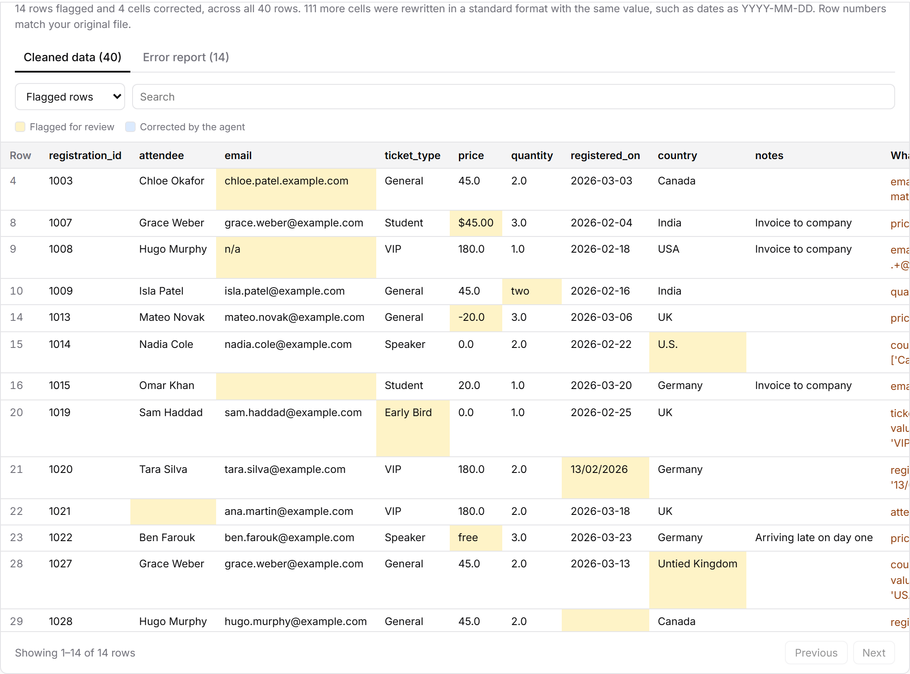
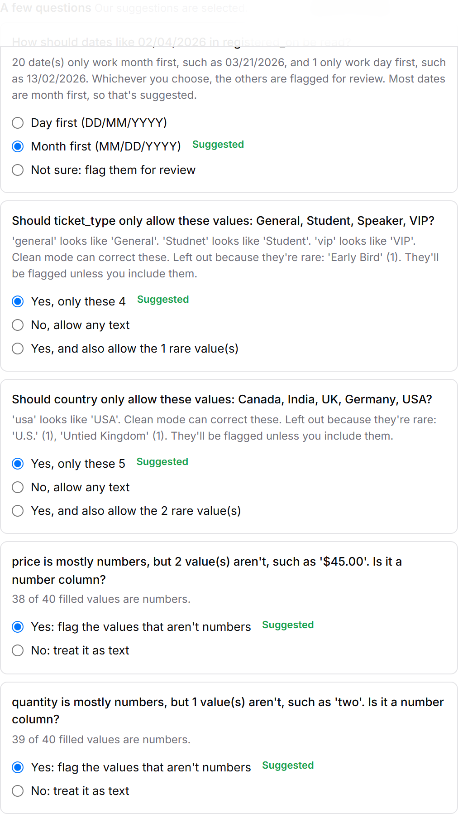
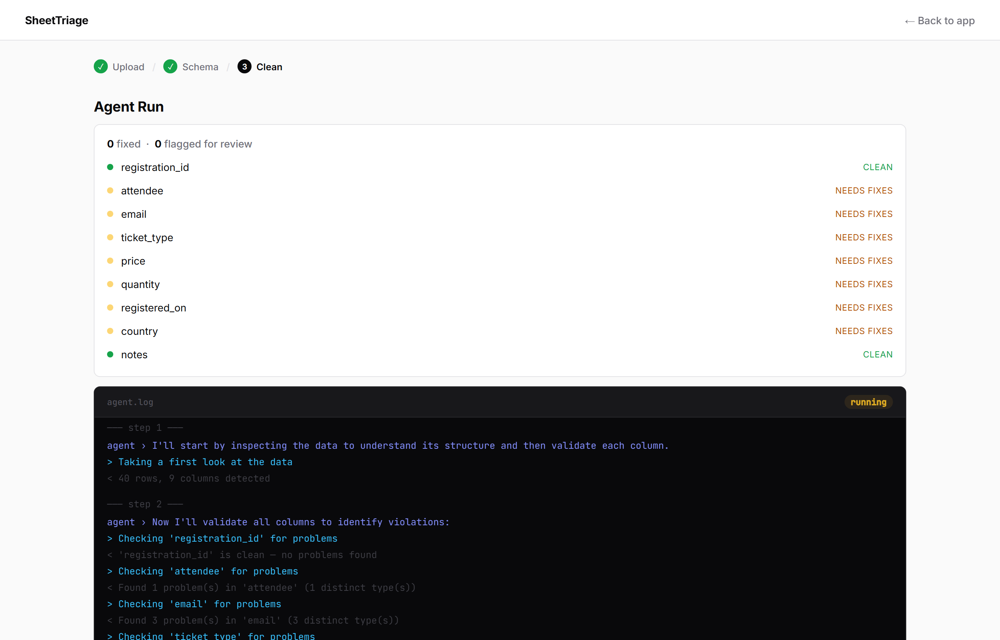
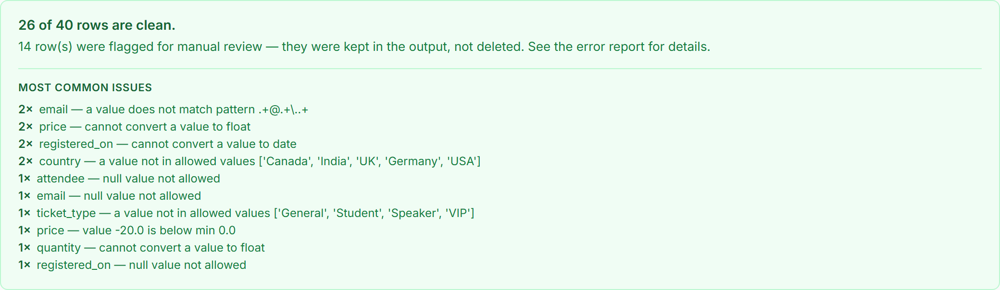

# SheetTriage

[](https://github.com/rajeev-thundiyil15/SheetTriage/actions/workflows/tests.yml)

An AI agent that cleans messy CSV files: it fixes what it can safely fix, flags everything else for review, and never quietly changes or drops your data.

**Try it:** [sheettriage-production.up.railway.app](https://sheettriage-production.up.railway.app/app) and upload any CSV. No sign-up needed. For a file with known problems, download [`static/demo/event_registrations.csv`](static/demo/event_registrations.csv) (40 rows, 24 planted problems). Running locally, the upload page also has a **Try demo data** button.

Built with Python, FastAPI, pandas and Claude Haiku 4.5 (tool use), with pytest and Playwright tests running on every push.



---

## How it works

1. **Upload a CSV.** Excel exports work too: Windows encodings and semicolon-separated files are read correctly.
2. **Confirm the schema.** SheetTriage scans the file and drafts the rules (types, allowed values, date order, required columns). It only asks about things a wrong guess would get wrong, and pre-selects its suggestion. You can add rules in plain English.
3. **Run the agent.** Claude works through the file with a set of pandas tools, column by column, while you watch the progress live.
4. **Review the results** on the page: flagged cells highlighted, corrections marked, an error report you can filter, and both files to download.

| Mode | What happens to your data |
|---|---|
| **Audit only** | Nothing changes. You get a report of every problem. |
| **Clean + report** (default) | Safe fixes are applied. Everything else is flagged in an `_errors` column. Every row is kept. |
| **Strict clean** | Same fixes, and rows that still have problems are left out of the output (they stay in the report). |

| Schema page | While the agent runs | Summary |
|---|---|---|
|  |  |  |

---

## Design decisions

### 1. The agent never invents a value

A data-cleaning tool that silently "fixes" things can't be trusted, so the tools enforce this rather than the prompt:

- A correction to an allowed value goes through only if it's a case change or a close typo of an allowed value (`vip` → `VIP`, `Studnet` → `Student`). The tool refuses anything else, such as `Early Bird` → `General` or `U.S.` → `USA`, and the value is flagged instead. This rule came from a live test where the model made exactly those guesses.
- A value that can't be converted keeps its original text and is flagged. Nothing becomes blank.
- Rows are never deleted unless you choose strict mode.
- The review counts real corrections separately from cells that were only rewritten in a standard format (`02/14/2026` → `2026-02-14`), so "4 cells corrected" means 4.

### 2. The agent can't finish early

`save_with_report` refuses to save until every column has been checked again after its last change and shows zero open problems. This closed a real bug where the agent reported "all clean" partway through a run.

### 3. Cost depends on agent steps, not rows

The agent never sees the rows themselves. Tools return summaries: problems are grouped by issue with a count and five example rows, and every result fits in the 4,000 characters the agent is shown. Flagging happens on the server (`mark_remaining_violations`), so the agent never sends row lists back.

A clean run on 30,000 rows took 10 agent steps, the same as on 5,000. Keeping results small matters: before the cap, the country check on the 30,000-row file ran to 6,705 characters. That pushed `usa` and `uk` past the cut-off, so the agent never saw them and flagged 108 rows it should have fixed. A test now covers that case.

### 4. The schema is drafted without an API call

The schema page is plain Python (`schema_profile.py`). It turns a guess into a question only when a wrong guess would change data, and settles the rest itself with a stated reason. For example, when one date order clearly wins it shows the counts ("16,908 dates only work month first, 101 only work day first") and pre-selects it. Claude is only called if you write rules in plain English.

### 5. Haiku, because the work is in the tools

Validation and fixing are deterministic pandas code. The model only decides which tool to call next, and Haiku 4.5 does that reliably at a fraction of the price of larger models. Measured costs are below.

### 6. Private by default, cheap to run

- **Every run belongs to someone.** Uploads, runs and results are saved in SQLite plus files on a Railway volume, each owned by a signed-in account or by the browser that made it. Every page, review and download checks the owner, and anyone else is told the run doesn't exist.
- **Signing in is optional.** Without it, results are kept for an hour in that browser. Signing in with Google keeps them for 7 days in My files, on any device. SheetTriage never stores passwords.
- **Runs are limited, so nobody can run up the bill.** Everyone not on a paid plan gets 3 runs a day: visitors are counted by a scrambled form of their address, and free accounts by account, so signing in never means fewer runs.
- **Each run's cost is recorded.** The tokens of every Claude request go on the run's record, and `costs.py` reports what runs really cost by file size.
- **Two runs at once.** Each run's working data is kept per thread, so runs side by side never touch each other's data. A few more wait their turn.

---

## Testing

- **235 unit tests** (pytest) cover the tools, the save check, schema drafting, upload parsing, the review page data and error messages, plus saved runs, who can open them, sign-in (including forged and expired Google tokens), run limits, deleting, and two runs at once. None call the API.
- **18 browser tests** (Playwright, TypeScript) run the real app with a scripted agent, so they're free and give the same result every time. They use page objects (`e2e/pages/`) for the upload, schema, results and My files pages, and the account menu:
  - upload to review;
  - refreshing the results page;
  - the demo button from start to finish;
  - script code in a CSV shown as text and never run;
  - both downloads holding the right rows;
  - no sideways scrolling at phone width;
  - a file with a malformed row being refused;
  - a semicolon CSV from Excel;
  - a run that fails partway;
  - two people running files at the same time;
  - running out of free runs;
  - and, on a second test server with sign-in turned on: a visitor cleaning a file without signing in, a signed-in run saved to My files, another account opening your link, runs moving to the account on sign-in, deleting a run, deleting an account, and My files at phone width.
- **3 Cucumber scenarios** in plain English ([`e2e/features/`](e2e/features/clean-a-file.feature)), run by playwright-bdd with the same page objects: the demo from start to finish, a value that breaks a rule being flagged rather than changed, and an unreadable file being refused.
- **GitHub Actions** runs all of these and a TypeScript check on every push, keeps the Playwright report and traces, and publishes the latest report from master to [GitHub Pages](https://rajeev-thundiyil15.github.io/SheetTriage/).
- **Live accuracy runs** on the deployed site, using generated files with known planted problems:

| File | Mode | Agent steps | Time | Rows flagged | Expected |
|---|---|---|---|---|---|
| 40 rows, run 3 times | Clean | 8–9 | about 22 s | 18, the same 18 each time | 18 |
| 5,000 rows | Audit | 6 | 18 s | 378, nothing changed | 378 |
| 5,000 rows | Clean | 10 | 27 s | 318 | 318 |
| 5,000 rows | Strict | 8 | 26 s | 318, left out of the output | 318 |
| 30,000 rows | Clean | 10 | about 2 min | 1,935 | 1,935 |

The 40-row file and its answer key are in [`data/`](data/test_registrations_answer_key.md).

```bash
# Unit tests
uv run --no-project --with-requirements requirements-dev.txt python -m pytest

# Browser tests (from e2e/; starts the app with the scripted agent on port 8010)
cd e2e && npm ci && npx playwright install chromium && npm test
```

---

## Cost

These figures were estimated by replaying a clean run with Anthropic's token-counting endpoint, at Haiku 4.5 prices ($1 per million input tokens, $5 per million output tokens):

| File | Typical run (8 requests) | Long run (30 requests) |
|---|---|---|
| 5,000 rows | $0.07 | $0.27 |
| 50,000 rows | $0.11 | $0.42 |

The system prompt and tool definitions are marked for prompt caching. At about 2,400 tokens they are under Haiku 4.5's 4,096-token minimum, so caching doesn't take effect yet.

---

## Run it locally

Requires [uv](https://docs.astral.sh/uv/getting-started/installation/).

```bash
git clone https://github.com/rajeev-thundiyil15/SheetTriage.git
cd SheetTriage
cp .env.example .env        # then paste your Anthropic API key
uv run --no-project --with-requirements requirements.txt uvicorn app:app --reload
```

Open [http://localhost:8000/app](http://localhost:8000/app).

To try accounts locally without Google, add `AUTH_MODE=dev` to `.env`: the sign-in page then takes any email with no password. `.env.example` lists the settings for Google sign-in.

There's also a command-line version:

```bash
uv run --no-project --with-requirements requirements.txt python main.py data/test_registrations.csv schema/registrations.json
```

---

## Project structure

```
├── app.py               # FastAPI routes: upload, schema draft, run, live stream, review, download, accounts
├── storage.py           # SQLite and files on disk: uploads, runs, progress, accounts
├── auth.py              # Who is asking: browser session, Google sign-in, the test sign-in
├── costs.py             # What runs have really cost, from their recorded tokens
├── agent.py             # The agent loop: Claude tool use, mode prompts, plain-text log
├── tools.py             # pandas tools the agent calls, and the save check
├── csv_input.py         # Reads each upload once into standard UTF-8 CSV
├── schema_profile.py    # Drafts the schema and its questions without an API call
├── schema_infer.py      # Applies plain-English rules with one Claude call
├── review.py            # Lines the output up with the original for the review page
├── schema.py            # Pydantic schema models
├── main.py              # Command-line entry point
├── static/              # Pages: home, upload, schema, results, My files, sign-in, privacy, terms, plus the demo CSV
├── schema/              # Example schemas (registrations matches the test data)
├── data/                # 40-row test file and its answer key
├── tests/               # pytest suite
├── e2e/                 # Playwright specs, Cucumber features, page objects and the scripted agent server
└── docs/screenshots/
```

## Schema format

```json
{
  "name": "event_registrations",
  "columns": {
    "email":         { "dtype": "str",   "nullable": false, "pattern": ".+@.+\\..+" },
    "ticket_type":   { "dtype": "str",   "nullable": false, "allowed_values": ["General", "VIP", "Student", "Speaker"] },
    "price":         { "dtype": "float", "nullable": false, "min_value": 0, "max_value": 500 },
    "registered_on": { "dtype": "date",  "nullable": false, "date_format": "MDY" },
    "notes":         { "dtype": "str",   "nullable": true }
  }
}
```

Types: `int`, `float`, `str`, `date`. `date_format` is `MDY`, `DMY` or `YMD`, and only matters for dates like `03/04/2026` that could be read either way.

## Known limitations

- Two runs at a time, with up to four more waiting. Memory use per run on Railway hasn't been measured yet.
- A run that's going when the server restarts is cut short, and is offered again.
- No paid plan yet: billing is the next phase.

## License

MIT — see [LICENSE](LICENSE).
