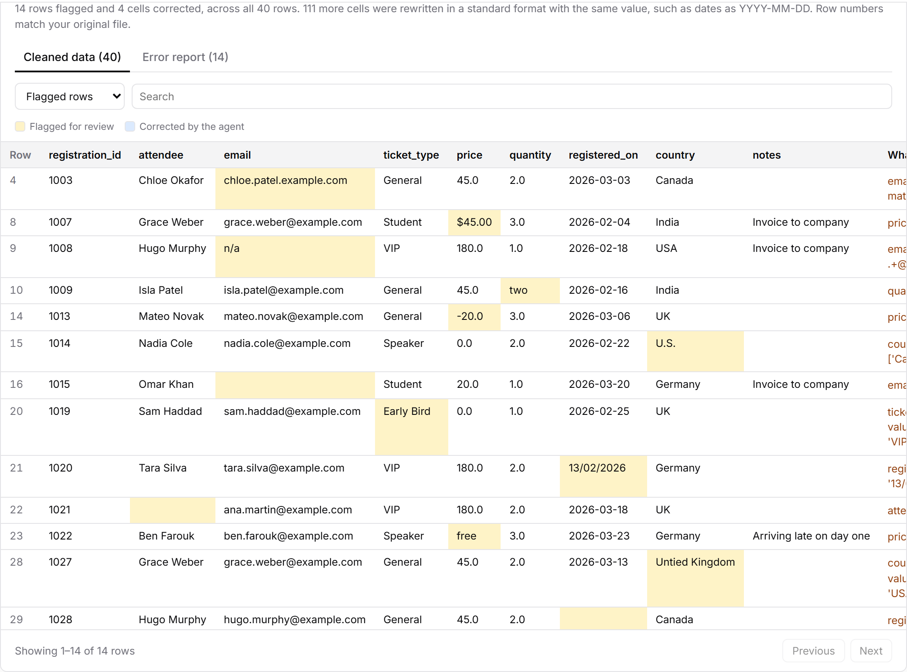
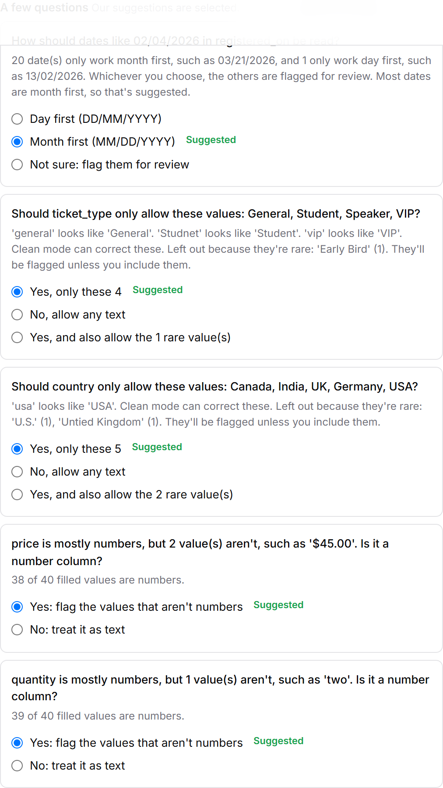
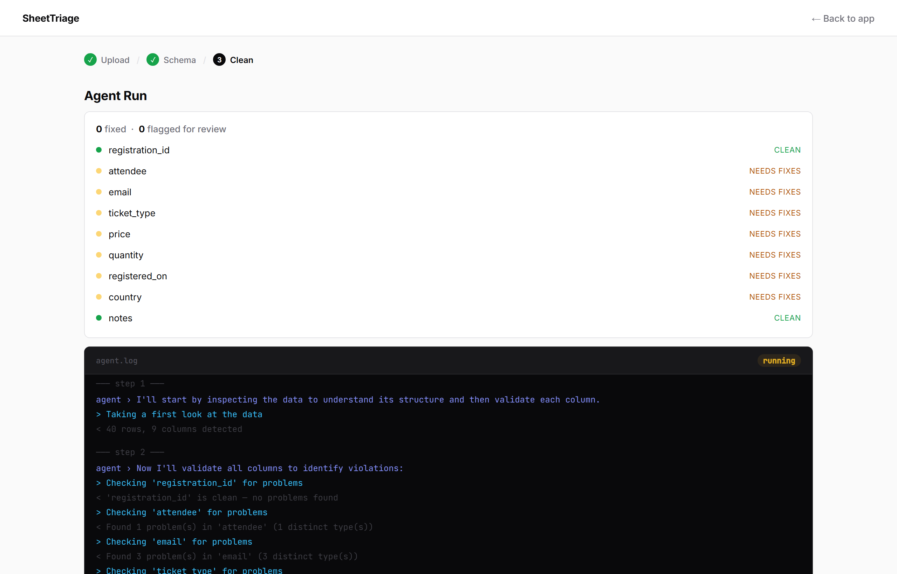
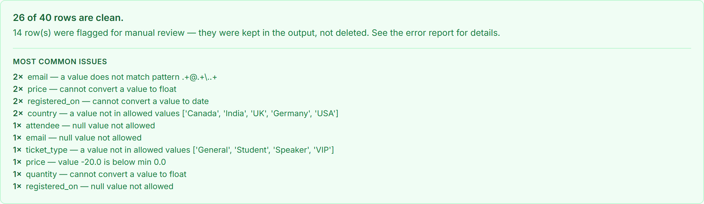

# SheetTriage

[](https://github.com/rajeev-thundiyil15/SheetTriage/actions/workflows/tests.yml)

An AI agent that cleans messy CSV files: it fixes what it can safely fix, flags everything else for review, and never quietly changes or drops your data.

**Try it:** [sheettriage-production.up.railway.app](https://sheettriage-production.up.railway.app/app) and upload any CSV. No sign-up needed. For a file with known problems, download [`static/demo/event_registrations.csv`](static/demo/event_registrations.csv) (40 rows, 24 planted problems). Running locally, the upload page also has a **Try demo data** button.

Built with Python, FastAPI, pandas and Claude Haiku 5.5 (tool use), with pytest and Playwright tests running on every push.



---

## How it works

1. **Upload a CSV.** Excel exports work too: Windows encodings and semicolon-separated files are read correctly.
2. **Confirm the schema.** SheetTriage scans the file and drafts the rules (types, allowed values, date order, required columns). It only asks about things a wrong guess would get wrong, and pre-selects its suggestion. You can add rules in plain English.
3. **Run the agent.** Claude works through the file with a set of pandas tools, column by column, while you watch the progress live.
4. **Review the results** on the page: flagged cells highlighted, corrections marked, an error report you can filter, and both files to download.
5. **Approve suggested fixes.** For flagged cells where a fix can be backed up, Claude recommends one with a reason, and duplicate rows are offered for removal. Nothing changes until you choose, and the downloads include your choices.

| Mode | What happens to your data |
|---|---|
| **Audit only** | Nothing changes. You get a report of every problem. |
| **Clean + report** (default) | Safe fixes are applied. Everything else is flagged in an `_errors` column. Every row is kept. |
| **Strict clean** | Same fixes, and rows that still have problems are left out of the output (they stay in the report). |

| Schema page | While the agent runs | Summary |
|---|---|---|
|  |  |  |

---

## Design decisions

### 1. The agent never invents a value

A data-cleaning tool that silently "fixes" things can't be trusted, so the tools enforce this rather than the prompt:

- A correction to an allowed value goes through only if it's a case change or a close typo of an allowed value (`vip` → `VIP`, `Studnet` → `Student`). The tool refuses anything else, such as `Early Bird` → `General` or `U.S.` → `USA`, and the value is flagged instead. This rule came from a live test where the model made exactly those guesses.
- A value that can't be converted keeps its original text and is flagged. Nothing becomes blank.
- Rows are never deleted unless you choose strict mode.
- The review counts real corrections separately from cells that were only rewritten in a standard format (`02/14/2026` → `2026-02-14`), so "4 cells corrected" means 4.

### 2. The agent can't finish early

`save_with_report` refuses to save until every column has been checked again after its last change and shows zero open problems. This closed a real bug where the agent reported "all clean" partway through a run.

### 3. Cost depends on agent steps, not rows

The agent never sees the rows themselves. Tools return summaries: problems are grouped by issue with a count and five example rows, and every result fits in the 4,000 characters the agent is shown. Flagging happens on the server (`mark_remaining_violations`), so the agent never sends row lists back.

A clean run on 30,000 rows took 10 agent steps, the same as on 5,000. Keeping results small matters: before the cap, the country check on the 30,000-row file ran to 6,705 characters. That pushed `usa` and `uk` past the cut-off, so the agent never saw them and flagged 108 rows it should have fixed. A test now covers that case.

### 4. The schema is drafted without an API call

The schema page is plain Python (`schema_profile.py`). It turns a guess into a question only when a wrong guess would change data, and settles the rest itself with a stated reason. For example, when one date order clearly wins it shows the counts ("16,908 dates only work month first, 101 only work day first") and pre-selects it. Claude is only called if you write rules in plain English.

### 5. Haiku, because the work is in the tools

Validation and fixing are deterministic pandas code. The model only decides which tool to call next, and Haiku does that reliably at a fraction of the price of larger models. The app moved from Haiku 4.5 to Haiku 5.5 after both flagged exactly the right rows on the test files (below), with 5.5 costing about a tenth as much. `CLAUDE_MODEL` switches models without a code change.

### 6. The AI recommends; you approve

Fixing everything automatically would mean guessing, and flagging everything leaves the person with a list of chores. So for each flagged cell the code works out the fixes it can back up: the closest allowed values, the other reading of a date, the last day of the month for an impossible date, a number without its currency sign. Claude recommends one with a plain reason, or says it isn't sure, and the person decides. Claude can only pick from the options the code found, so a recommendation can't be an invented value.

- **Duplicates** are found by code alone: rows that match in every column except an ID column, ignoring case and spaces.
- **Cells with the same value share one question to Claude.** On a 30,000-row test file, 712 fixable cells needed 57 questions, so suggestions cost a fraction of the run.
- **Decisions are applied on the way out.** The run's own files stay as they were; the review, the cleaned CSV and the error report show the person's choices.

### 7. Private by default, cheap to run

- **Every run belongs to someone.** Uploads, runs and results are saved in SQLite plus files on a Railway volume, each owned by a signed-in account or by the browser that made it. Every page, review and download checks the owner, and anyone else is told the run doesn't exist.
- **Signing in is optional.** Without it, results are kept for an hour in that browser. Signing in with Google keeps them for 7 days in My files, on any device. SheetTriage never stores passwords.
- **Runs are limited, so nobody can run up the bill.** Everyone not on a paid plan gets 3 runs a day: visitors are counted by a scrambled form of their address, and free accounts by account, so signing in never means fewer runs.
- **Or bring your own key.** Anyone with an Anthropic API key can add it on the schema page for unlimited runs, billed to their own account. The key is checked with one tiny request before the run starts, so a wrong key or an empty account fails at once. It's used for the agent and its suggestions, held in memory for that run only, and never written to the database, files or logs. The browser remembers it only if the person ticks the box.
- **Each run's cost is recorded.** The tokens of every Claude request go on the run's record, and `costs.py` reports what runs really cost by file size.
- **Two runs at once.** Each run's working data is kept per thread, so runs side by side never touch each other's data. A few more wait their turn.

---

## Testing

- **312 unit tests** (pytest) cover the tools, the save check, schema drafting, upload parsing, the review page data and error messages, plus saved runs, who can open them, sign-in (including forged and expired Google tokens), run limits, deleting, two runs at once, and suggested fixes: the options for each kind of problem, recommendations outside the options being ignored, duplicates, decisions and the downloads that follow them. Visitors' own API keys are covered too: the key reaching both the agent and the suggestions, those runs not counting toward the limit, a refused key stopping the run before it starts, and the key never appearing in the database, the run's files or an error message. None call the API.
- **25 browser tests** (Playwright, TypeScript) run the real app with a scripted agent, so they're free and give the same result every time. They use page objects (`e2e/pages/`) for the upload, schema, results and My files pages, and the account menu:
  - upload to review;
  - refreshing the results page;
  - the demo button from start to finish;
  - script code in a CSV shown as text and never run;
  - both downloads holding the right rows;
  - no sideways scrolling at phone width;
  - a file with a malformed row being refused;
  - a semicolon CSV from Excel;
  - a run that fails partway;
  - two people running files at the same time;
  - running out of free runs;
  - running on your own API key, remembering it only when asked, and a refused or malformed key being explained beside the field;
  - turning columns on and off in the review;
  - approving suggested fixes, keeping a value and removing a duplicate, with the download following;
  - and, on a second test server with sign-in turned on: a visitor cleaning a file without signing in, a signed-in run saved to My files, another account opening your link, runs moving to the account on sign-in, deleting a run, deleting an account, and My files at phone width.
- **3 Cucumber scenarios** in plain English ([`e2e/features/`](e2e/features/clean-a-file.feature)), run by playwright-bdd with the same page objects: the demo from start to finish, a value that breaks a rule being flagged rather than changed, and an unreadable file being refused.
- **GitHub Actions** runs all of these and a TypeScript check on every push, keeps the Playwright report and traces, and publishes the latest report from master to [GitHub Pages](https://rajeev-thundiyil15.github.io/SheetTriage/).
- **Live accuracy runs** on the deployed site, using generated files with known planted problems:

| File | Mode | Agent steps | Time | Rows flagged | Expected |
|---|---|---|---|---|---|
| 40 rows, run 3 times | Clean | 8–9 | about 22 s | 18, the same 18 each time | 18 |
| 5,000 rows | Audit | 6 | 18 s | 378, nothing changed | 378 |
| 5,000 rows | Clean | 10 | 27 s | 318 | 318 |
| 5,000 rows | Strict | 8 | 26 s | 318, left out of the output | 318 |
| 30,000 rows | Clean | 10 | about 2 min | 1,935 | 1,935 |

The 40-row file and its answer key are in [`data/`](data/test_registrations_answer_key.md).

```bash
# Unit tests
uv run --no-project --with-requirements requirements-dev.txt python -m pytest

# Browser tests (from e2e/; starts the app with the scripted agent on port 8010)
cd e2e && npm ci && npx playwright install chromium && npm test
```

---

## Cost

Measured on Nov 23 with real runs in Clean + report mode, from the tokens each run recorded:

| File | Model | Rows flagged (expected) | Agent steps | Time | Cost |
|---|---|---|---|---|---|
| 40 rows, 7 columns | Haiku 4.5 | 18 (18) | 12 | 24 s | $0.085 |
| 40 rows, 7 columns | Haiku 5.5 | 18 (18) | 7 | 15 s | $0.005 |
| 30,000 rows, 18 columns | Haiku 5.5 | 1,278 (1,278) | 8 | about 2 to 2½ min | $0.018 |

On the 30,000-row file, Claude's recommendations for the suggested fixes added one request and about half a cent: it recommended a fix for 362 of the 411 cells that had one, and said it wasn't sure for the rest, such as 31/04/2026, which could mean 30 April or 1 May.

The system prompt and tool definitions are marked for prompt caching. Haiku 5.5 caches them (most of each run's later input is read from the cache); Haiku 4.5 didn't, because they're under its 4,096-token minimum.

---

## Run it locally

Requires [uv](https://docs.astral.sh/uv/getting-started/installation/).

```bash
git clone https://github.com/rajeev-thundiyil15/SheetTriage.git
cd SheetTriage
cp .env.example .env        # then paste your Anthropic API key
uv run --no-project --with-requirements requirements.txt uvicorn app:app --reload
```

Open [http://localhost:8000/app](http://localhost:8000/app).

To try accounts locally without Google, add `AUTH_MODE=dev` to `.env`: the sign-in page then takes any email with no password. `.env.example` lists the settings for Google sign-in.

There's also a command-line version:

```bash
uv run --no-project --with-requirements requirements.txt python main.py data/test_registrations.csv schema/registrations.json
```

---

## Project structure

```
├── app.py               # FastAPI routes: upload, schema draft, run, live stream, review, download, accounts
├── storage.py           # SQLite and files on disk: uploads, runs, progress, accounts
├── auth.py              # Who is asking: browser session, Google sign-in, the test sign-in
├── costs.py             # What runs have really cost, from their recorded tokens
├── agent.py             # The agent loop: Claude tool use, mode prompts, plain-text log
├── tools.py             # pandas tools the agent calls, and the save check
├── csv_input.py         # Reads each upload once into standard UTF-8 CSV
├── schema_profile.py    # Drafts the schema and its questions without an API call
├── schema_infer.py      # Applies plain-English rules with one Claude call
├── review.py            # Lines the output up with the original for the review page
├── suggestions.py       # Suggested fixes for flagged cells and likely duplicates, and applying decisions
├── schema.py            # Pydantic schema models
├── main.py              # Command-line entry point
├── static/              # Pages: home, upload, schema, results, My files, sign-in, privacy, terms, plus the demo CSV
├── schema/              # Example schemas (registrations matches the test data)
├── data/                # Test files with answer keys, and a generator for large shop orders files
├── tests/               # pytest suite
├── e2e/                 # Playwright specs, Cucumber features, page objects and the scripted agent server
└── docs/screenshots/
```

## Schema format

```json
{
  "name": "event_registrations",
  "columns": {
    "email":         { "dtype": "str",   "nullable": false, "pattern": ".+@.+\\..+" },
    "ticket_type":   { "dtype": "str",   "nullable": false, "allowed_values": ["General", "VIP", "Student", "Speaker"] },
    "price":         { "dtype": "float", "nullable": false, "min_value": 0, "max_value": 500 },
    "registered_on": { "dtype": "date",  "nullable": false, "date_format": "MDY" },
    "notes":         { "dtype": "str",   "nullable": true }
  }
}
```

Types: `int`, `float`, `str`, `date`. `date_format` is `MDY`, `DMY` or `YMD`, and only matters for dates like `03/04/2026` that could be read either way.

## Known limitations

- Two runs at a time, with up to four more waiting. Memory use per run on Railway hasn't been measured yet.
- A run that's going when the server restarts is cut short, and is offered again.
- No paid plan yet: billing is the next phase.

## License

MIT — see [LICENSE](LICENSE).
